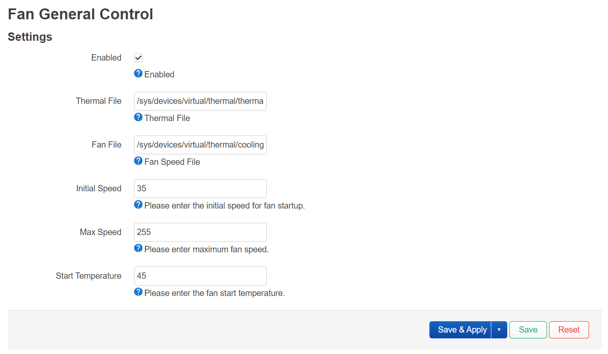

# Fan Control for OpenWrt

[English](README.md) | [简体中文](README.zh-CN.md)

Fan Control is a userspace temperature controller for fans exposed through the
Linux hwmon PWM ABI. It writes the standard `pwmN` interface (`0..255`) directly,
so continuous PWM control does not depend on a detailed Device Tree
`cooling-levels` table.



## Hardware requirements

The device must expose a writable hwmon PWM output:

```text
/sys/class/hwmon/hwmonN/pwm1
```

The kernel `pwm-fan` driver provides this interface on generic PWM-controlled
fans. Many Super-I/O and embedded-controller hwmon drivers expose the same ABI.
Fans connected only through a GPIO have no variable-duty hardware and cannot
support continuous speed control in software.

Device Tree is still responsible for describing the PWM controller, channel,
period, polarity and pins. `cooling-levels` may remain as a coarse kernel
thermal fallback, but Fan Control does not use it for its normal control curve.

## Control curve

- Below `start_temp`, the fan is stopped.
- At `start_temp`, the output starts at `start_speed`.
- Between `start_temp` and `full_speed_temp`, PWM is interpolated linearly.
- At and above `full_speed_temp`, the output is `max_speed`.
- Once running, the fan stops at `start_temp - hysteresis`.

An optional full-speed startup kick helps fans that cannot start reliably at a
low duty cycle. Temperature read failures and daemon shutdown use configurable
fail-safe PWM values, both defaulting to full speed.

## Hardware discovery

With the default `auto` settings, the daemon:

1. Prefers CPU or SoC thermal zones and otherwise uses the first readable
   thermal zone. If the system has no thermal zones, it falls back to a readable
   hwmon `tempN_input`, preferring CPU or SoC sensors.
2. Prefers an hwmon device named `pwmfan` and otherwise uses the first writable
   standard `pwmN` output.
3. Writes `1` to the matching `pwmN_enable` node when available to select manual
   control.
4. Reads the matching `fanN_input` tachometer when available.
5. Pairs a single `pwmfan` hwmon device with a single `pwm-fan` cooling device
   and pauses conflicting kernel fan control as described below.

Every path and device name can be selected explicitly for systems with multiple
sensors or fans. A `cooling_deviceN/cur_state` path is rejected because it is a
discrete cooling-state index rather than a continuous PWM output.

## Kernel fan control

`user_space` and `step_wise` are kernel thermal governors, not different Fan
Control curves. With `user_space`, no takeover is needed. With `step_wise`,
the daemon saves and temporarily invalidates only the active trips bound
exclusively to the selected fan, using the kernel's `THERMAL_TEMP_INVALID`
value. This prevents the kernel from overwriting the PWM curve. Thermal zones
stay enabled, and hot, critical and passive trips are not changed.

On a normal stop, the daemon writes `exit_speed` and restores the original fan
trips. Original thresholds are journaled in `/var/run/fancontrol.status.thermal`
before any changes. If the process is killed without cleanup, the next start
recovers that journal before taking control again. OpenWrt procd supervises and
restarts the daemon.

`cooling_device` defaults to `auto`. For multiple PWM fans, explicitly select
the matching directory, such as `/sys/class/thermal/cooling_device0`; sysfs
does not expose a reliable automatic association between multiple fans and
cooling devices. Use `none` only when kernel fan control is already handled
elsewhere. Unsupported governors, read-only trips, and trips shared with other
cooling devices are rejected instead of disabling other thermal controls.

## Configuration

The package installs `/etc/config/fancontrol`:

```uci
config fancontrol 'settings'
	option enabled '0'
	option thermal_file 'auto'
	option thermal_zone 'auto'
	option fan_file 'auto'
	option fan_hwmon 'auto'
	option enable_file 'auto'
	option cooling_device 'auto'
	option start_temp '45'
	option full_speed_temp '85'
	option hysteresis '3'
	option start_speed '64'
	option max_speed '255'
	option kick_speed '255'
	option kick_ms '500'
	option fail_safe_speed '255'
	option exit_speed '255'
	option temp_div '1000'
	option interval '5'
```

`thermal_file` values normally contain millidegrees Celsius, so `temp_div=1000`
is the default. Set it to `1` for sensors that report degrees Celsius.

## Add as an OpenWrt feed

```sh
echo "src-git fancontrol https://github.com/JiaY-shi/fancontrol.git" >> feeds.conf
./scripts/feeds update fancontrol
./scripts/feeds install -a -f -p fancontrol
```

Select `fancontrol` and optionally `luci-app-fancontrol` in the OpenWrt package
configuration, then build the packages normally.
