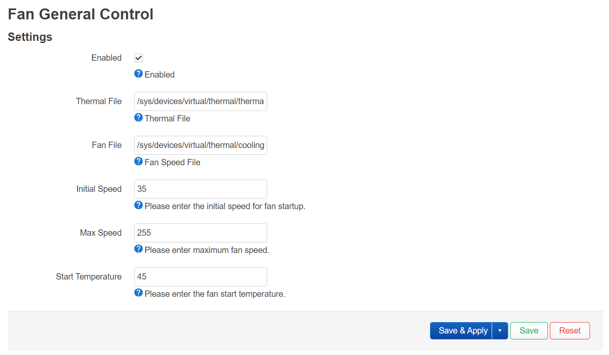

# OpenWrt 风扇控制

[English](README.md) | [简体中文](README.zh-CN.md)

Fan Control 是一个用户空间温控程序，用于控制通过 Linux hwmon PWM ABI
暴露的风扇。它直接写入标准 `pwmN` 接口（`0..255`），因此无级 PWM 调速
不依赖设备树中细分的 `cooling-levels` 档位表。



## 硬件要求

设备必须提供可写的 hwmon PWM 输出：

```text
/sys/class/hwmon/hwmonN/pwm1
```

内核 `pwm-fan` 驱动会为通用 PWM 风扇提供此接口，许多 Super-I/O 和嵌入式
控制器的 hwmon 驱动也使用相同 ABI。仅通过 GPIO 开关连接的风扇没有可变占空比
硬件，无法通过软件实现无级调速。

设备树仍需描述 PWM 控制器、通道、周期、极性和引脚。`cooling-levels` 可以保留
为内核的粗粒度温控后备方案，但 Fan Control 的正常温控曲线不会使用它。

## 温控曲线

- 温度低于 `start_temp` 时，风扇停止。
- 温度达到 `start_temp` 时，从 `start_speed` 开始运行。
- 在 `start_temp` 与 `full_speed_temp` 之间，PWM 进行线性插值。
- 温度达到或超过 `full_speed_temp` 时，输出 `max_speed`。
- 风扇启动后，温度降至 `start_temp - hysteresis` 时才会停止。

可选的全速启动助推可以帮助低占空比下无法可靠启动的风扇。温度读取失败和守护
进程退出时会使用可配置的保护 PWM，二者默认均为全速。

## 硬件自动发现

使用默认的 `auto` 设置时，守护进程会：

1. 优先选择 CPU 或 SoC thermal zone，否则使用第一个可读的 thermal zone。
   如果系统没有 thermal zone，则回退到可读的 hwmon `tempN_input`，并优先选择
   CPU 或 SoC 传感器。
2. 优先选择名称为 `pwmfan` 的 hwmon 设备，否则使用第一个可写的标准 `pwmN`
   输出。
3. 如果存在匹配的 `pwmN_enable`，则写入 `1` 以选择手动 PWM 控制模式。
4. 如果存在匹配的 `fanN_input`，则读取风扇转速反馈。
5. 将唯一的 `pwmfan` hwmon 设备与唯一的 `pwm-fan` 散热设备配对，按下述方式
   暂停与用户空间调速冲突的内核风扇控制。

对于带有多个传感器或风扇的系统，可以明确指定每个路径和设备名称。
`cooling_deviceN/cur_state` 是离散的散热状态索引，不是连续 PWM 输出，因此会被
拒绝。

## 内核风扇控制

`user_space` 和 `step_wise` 是内核 thermal governor，不是两套 Fan Control
温控曲线。内核使用 `user_space` 时无需接管；使用 `step_wise` 时，程序会保存
并临时停用仅绑定到当前风扇的 `active` 触发点，写入内核定义的
`THERMAL_TEMP_INVALID` 值，避免内核覆盖 PWM 输出。thermal zone 保持启用，
`hot`、`critical` 和 `passive` 触发点不会被修改。

服务正常退出时，先写入 `exit_speed`，再恢复原来的风扇触发点。修改前会将
原始阈值保存到 `/var/run/fancontrol.status.thermal`；如果进程被强制终止而
未执行清理，下次启动时会先恢复这份记录，再重新接管。OpenWrt procd 负责
监控和重启服务。

`cooling_device` 默认为 `auto`。存在多个 PWM 风扇时，需明确指定与当前风扇
对应的目录，例如 `/sys/class/thermal/cooling_device0`；sysfs 未提供可用于
多风扇自动配对的可靠关联。只有已通过其他方式处理内核风扇控制时才使用 `none`。
对于不支持的 governor、只读触发点，或与其他散热设备共用的触发点，程序会拒绝
接管，避免影响其他温控功能。

## 配置

软件包会安装 `/etc/config/fancontrol`：

```uci
config fancontrol 'settings'
	option enabled '0'
	option thermal_file 'auto'
	option thermal_zone 'auto'
	option fan_file 'auto'
	option fan_hwmon 'auto'
	option enable_file 'auto'
	option cooling_device 'auto'
	option start_temp '45'
	option full_speed_temp '85'
	option hysteresis '3'
	option start_speed '64'
	option max_speed '255'
	option kick_speed '255'
	option kick_ms '500'
	option fail_safe_speed '255'
	option exit_speed '255'
	option temp_div '1000'
	option interval '5'
```

`thermal_file` 通常以毫摄氏度为单位，因此 `temp_div` 默认为 `1000`。如果传感器
直接报告摄氏度，请将其设为 `1`。

## 添加为 OpenWrt feed

```sh
echo "src-git fancontrol https://github.com/JiaY-shi/fancontrol.git" >> feeds.conf
./scripts/feeds update fancontrol
./scripts/feeds install -a -f -p fancontrol
```

在 OpenWrt 软件包配置中选择 `fancontrol`，并按需选择
`luci-app-fancontrol`，然后正常编译即可。
